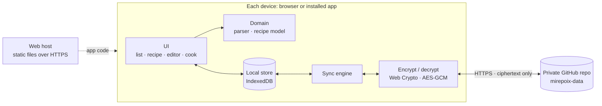

# Mirepoix

The Queiroga way of capturing and using recipes.

Mirepoix is a private recipe box that works on every device. You paste or type recipes from books, sites and notebooks, a chunk at a time if that's how they come, and Mirepoix turns every ingredient line into **quantity, unit and name**. You can read and cook from a recipe without ever changing it by accident, and leave notes for your future self while you cook.

> **Status:** planning. Nothing runs yet.
> See the [mockups](docs/mockups/index.html) (open the file in a browser), the [decisions](DECISIONS.md) and the [next work](TASKBOARD.md).

## What you get, release by release

Every release is usable on its own; each one adds to the last.

| Release | What you get |
| --- | --- |
| **R1 · Recipe box** | Paste or type recipes into sections (Ingredients, Preparation, Variations, Notes). Ingredients are parsed in English and Portuguese, including equivalents like "2 cups (437 g)". A read-only recipe view, search, export/import, and offline use. Recipes live on that one device. |
| **R2 · Every device** | The same recipes everywhere, synced end-to-end encrypted through a private GitHub repository. |
| **R3 · Cook mode** | Big type, the screen stays on, tick off ingredients and steps, and add dated notes without touching the recipe. |
| **R4 · Smart paste** | Paste a whole recipe (or any chunk) in one go, and Mirepoix finds the sections. |
| **R5 · Measures your way** | Weights or volumes first, more ways to write equivalents, and your own units. |

## Principles

These are distilled from [USER-MIND.md](USER-MIND.md). When in doubt, they win.

1. **Useful from the first release, better with every release.** Ship small working slices. Completeness comes with time.
2. **No bloat**, visually, functionally and in the code. Zero runtime dependencies.
3. **Private by default.** Recipes are encrypted on the device before they go anywhere.
4. **Zippy for returning users.** Open it, and the recipes are there. No login dance.
5. **Reading never edits.** Changing a recipe is always a deliberate act.
6. **Every released behavior is tested** and stays tested.

## How it works



- **The app is static files.** It's an installable web app (PWA) served from a regular web host. A service worker keeps it on the device, so it starts instantly and works offline.
- **Each device keeps a full copy** of the recipes in IndexedDB. The UI never waits on the network.
- **Sync** stores one encrypted file per recipe in a private GitHub repository through GitHub's API. A returning device needs one small request to know whether anything changed, and every save is a commit, so history comes for free.
- **Encryption** happens on the device, with a key derived from your passphrase. GitHub only ever stores ciphertext. The passphrase is typed once per device.

The full reasoning, alternatives and trade-offs are in [DECISIONS.md](DECISIONS.md).

## Tech at a glance

| Concern | Choice |
| --- | --- |
| App | Installable web app (PWA): plain JavaScript ES modules and hand-written HTML/CSS. No framework, no bundler, zero runtime dependencies. |
| Data on the device | IndexedDB |
| Sync | Private GitHub repository via the REST API, with a fine-grained token per device |
| Encryption | AES-256-GCM, with the key derived from a passphrase by PBKDF2, using the browser's Web Crypto API |
| Languages | Recipes in English or Portuguese (per recipe); UI in English |
| Tooling | Node.js LTS, `node --test`, Playwright (Chromium + WebKit), TypeScript for type-checking JSDoc |
| Hosting | Static files over HTTPS on the existing web host |

## Repository layout

This is where things will live as R1 is built:

```text
app/              the shipped app; deploy this folder as-is
  domain/         pure logic: recipe model, ingredient parser, quantities
  store/          IndexedDB, GitHub remote, sync, crypto
  ui/             views and DOM helpers
  sw.js           service worker (offline + instant start)
test/
  unit/           node --test
  e2e/            Playwright journeys
  fixtures/       real ingredient lines (en, pt) with their expected parses
tools/            dev server and small scripts
docs/mockups/     static design mockups
DECISIONS.md      decision log
TASKBOARD.md      kanban in a file
USER-MIND.md      what the users think, want and imagine
```

## Development

You need Node.js LTS. These commands will work once task R1.1 is done:

```bash
npm install          # dev tools only: TypeScript and Playwright
npm run dev          # serve app/ locally
npm run check        # type-check
npm test             # unit tests
npm run test:e2e     # browser journeys on Chromium and WebKit
```

## Working agreements

- **USER-MIND.md** is the users' voice. Users write there; we interpret it and don't tidy it up.
- **DECISIONS.md** gets a new entry whenever a decision is made or changed.
- **TASKBOARD.md** changes in the same commit as the work it describes.
- **Done** means the behavior works, a test covers it, `check`, `test` and `test:e2e` all pass, and the taskboard is updated.
- **Git** is the maintainer's job. Changes are prepared locally and the maintainer reviews, commits and pushes them.

## License

To be defined.
