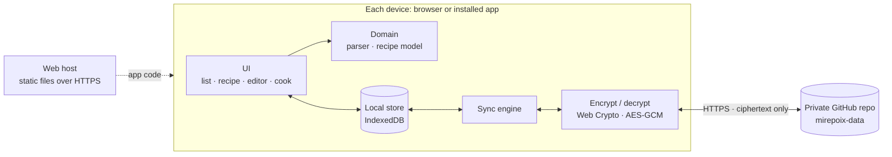

<picture>
  <source media="(prefers-color-scheme: dark)" srcset="app/icons/logo-stacked-dark.svg">
  
</picture>

# Mirepoix

The Queiroga way of capturing and using recipes.

Mirepoix is a private recipe box that works on every device. You paste or type recipes from books, sites and notebooks, a chunk at a time if that's how they come, and Mirepoix turns every ingredient line into **quantity, unit and name**. You can read and cook from a recipe without ever changing it by accident, and leave notes for your future self while you cook.

> See the [mockups](docs/mockups/index.html) (open the file in a browser), the [decisions](DECISIONS.md) and the [next work](TASKBOARD.md).

## What you get, release by release

Every release is usable on its own; each one adds to the last.

| Release | What you get |
| --- | --- |
| **R1 · Recipe box** | Paste or type recipes into sections (Ingredients, Preparation, Variations, Notes). Ingredients are parsed in English and Portuguese, including equivalents like "2 cups (437 g)". A read-only recipe view, search, export/import, and offline use. Screens in English or Portuguese. Recipes stay on the device they were captured on. |
| **R2 · Every device** | The same recipes everywhere, synced end-to-end encrypted through a private GitHub repository. Everyone's R1 recipes merge into one shared recipe box. |
| **R3 · Cook mode** | Big type, the screen stays on, tick off ingredients and steps, and add dated notes without touching the recipe. |
| **R4 · Smart paste** | Paste a whole recipe (or any chunk) in one go, and Mirepoix finds the sections. |
| **R5 · Your measures** | More ways to write equivalents ("2 cups / 437 g", "2 xícaras ou 437 g") and your own units. |

## Principles

These are distilled from [USER-MIND.md](USER-MIND.md). When in doubt, they win.

1. **Useful from the first release, better with every release.** Ship small working slices. Completeness comes with time.
2. **No bloat**, visually, functionally and in the code. Zero runtime dependencies.
3. **Private by default.** Recipes are encrypted on the device before they go anywhere.
4. **Zippy for returning users.** Open it, and the recipes are there. No login dance.
5. **Reading never edits.** Changing a recipe is always a deliberate act.
6. **Every released behavior is tested** and stays tested.

## How it works



- **The app is static files.** It's an installable web app (PWA) served from a regular web host. A service worker keeps it on the device, so it starts instantly and works offline.
- **Each device keeps a full copy** of the recipes in IndexedDB. The UI never waits on the network.
- **Sync** stores one encrypted file per recipe in a private GitHub repository through GitHub's API. A returning device needs one small request to know whether anything changed, and every save is a commit, so history comes for free.
- **Encryption** happens on the device, with a key derived from your passphrase. GitHub only ever stores ciphertext. The passphrase is typed once per device.

The full reasoning, alternatives and trade-offs are in [DECISIONS.md](DECISIONS.md); syncing as built is D17.

### Setting up sync

Do this once, on GitHub:

1. Create a **private** repository for the recipes, e.g. `mirepoix-data`. It can start empty.
2. For each device, make a [fine-grained personal access token](https://github.com/settings/personal-access-tokens/new). From your profile picture at the top right: *Settings → Developer settings* (at the bottom of the left-hand menu) *→ Personal access tokens → Fine-grained tokens → Generate new token*. Then:
   - *Repository access*: *Only select repositories* → the recipes repository.
   - *Permissions*: *Contents* (a repository permission) → *Read and write*. Nothing else.
   - Copy the token straight away; GitHub shows it only once. One token per device means a lost phone can be cut off on its own.

   GitHub rearranges its menus now and then. If these names don't match, look for *Developer settings* and *Fine-grained tokens*, or search GitHub's help for "fine-grained personal access token".

Then, in Mirepoix, tap the chip in the corner of the recipe list (**This device only**):

- On the **first** device, choose **Start fresh**, and pick a passphrase of at least 8 characters. It can't be recovered, so keep a copy somewhere safe.
- On **every other** device, choose **Join my recipes**, with the same repository and passphrase and the device's own token.

Each device keeps the recipes it already had: connecting merges everyone's recipes into one box. If two people typed the same dish, both are kept, side by side. The chip then shows how syncing goes (*Synced*, *Offline*, *Token expired*…), and the Sync screen says what to do when it's stuck. **Export** still works, and makes a file that opens without GitHub or the passphrase.

## Tech at a glance

| Concern | Choice |
| --- | --- |
| App | Installable web app (PWA): plain JavaScript ES modules and hand-written HTML/CSS. No framework, no bundler, zero runtime dependencies. |
| Data on the device | IndexedDB |
| Sync | Private GitHub repository via the REST API, with a fine-grained token per device |
| Encryption | AES-256-GCM, with the key derived from a passphrase by PBKDF2, using the browser's Web Crypto API |
| Languages | Recipes in English or Portuguese (per recipe); screens in English or Portuguese, following the browser, with a switch at the bottom of the list (D15) |
| Tooling | Node.js LTS, `node --test`, Playwright (Chromium + WebKit), TypeScript for type-checking JSDoc |
| Hosting | Static files over HTTPS on the existing web host |
| Analytics | Google Analytics, opt-in, screen names only (D14). Off until `app/config.js` has a Measurement ID. |

## Repository layout

This is where things will live as R1 is built:

```text
app/              the shipped app; deploy this folder as-is
  domain/         pure logic: recipe model, ingredient parser, quantities
  store/          IndexedDB, GitHub remote, sync, crypto
  ui/             views and DOM helpers
  sw.js           service worker (offline + instant start)
test/
  unit/           node --test
  e2e/            Playwright journeys
  contract/       behavior shared by a real implementation and its test twin
  support/        test twins: the in-memory recipe store, a stand-in for GitHub's API
  fixtures/       real ingredient lines (en, pt) with their expected parses
tools/            dev server, icon renderer
.github/          CI: check, unit and e2e on every push
docs/mockups/     static design mockups
DECISIONS.md      decision log
TASKBOARD.md      kanban in a file
USER-MIND.md      what the users think, want and imagine
```

## Development

You need Node.js 24 LTS or newer.

```bash
npm install          # dev tools only: TypeScript and Playwright
npm run browsers     # once: download Playwright's Chromium and WebKit
npm run dev          # serve app/ at http://localhost:5173
npm run check        # type-check app/
npm test             # unit tests
npm run test:e2e     # browser journeys: desktop Chromium, iPhone-sized WebKit
npm run logos        # after editing app/icons/icon.svg: redraw the logos with the lettered name
npm run icons        # then re-render the PNGs: home-screen icons and the share preview
npm run release -- 0.1.1                              # set the version for a deploy
npm run check:deploy -- https://pauloq.com/mirepoix/  # check a deployed site
```

- The dev server sends the same Content-Security-Policy as production (D7), so an inline script or style fails locally and in the tests, not after a deploy.
- On `localhost` the service worker stays off, so edits show up on reload. Add `?sw` to the address to try offline behavior.
- Syncing needs a secure page: browsers only offer encryption on `https://` addresses, or on `localhost` on the same computer. A phone reaching a laptop's plain `http://` address can add and read recipes but can't connect; try syncing on a second device through the deployed `https://` site.
- The service worker's file list (`SHELL` in `app/sw.js`) must match the files in `app/`; a unit test fails when they drift. Its `VERSION` moves with `package.json`'s version, and bumping both is what makes installed devices pick up a release.
- The ingredient parser's expectations live in `test/fixtures/ingredients.en.txt` and `ingredients.pt.txt`, one case per line: `line => quantity | unit | name | note | equivalents | doubts`. When a real recipe line reads wrong, add it there first (the test fails), then fix the parser.
- Every word on screen lives in `app/ui/i18n.js`, in English and Portuguese; new text goes in both. Type-checking and `npm test` fail when Portuguese is missing something English has. Browser tests run with an English browser (`playwright.config.js`); the Portuguese ones set their own.
- Tests never touch real GitHub (D12). `test/support/fake-github.js` answers like the parts of GitHub's API that Mirepoix uses; browser tests route `api.github.com` to it, so separate browser contexts act as devices sharing one repository.
- Only `app/`, the code that ships, is type-checked. Tests and tools run as plain JavaScript, which keeps `@types/node` out of the dependency list.

## Deploy

The app is the `app/` folder as it is: no build step. It runs from any folder, over HTTPS. Today it lives at **https://pauloq.com/mirepoix/** (Apache shared hosting, uploaded over FTP/SFTP).

1. **Test:** `npm run check`, `npm test` and `npm run test:e2e` all pass.
2. **Version:** `npm run release -- 0.1.1` (the next number). Installed apps only pick up new files when the version changes.
3. **Upload** the *contents* of `app/` into the site's `mirepoix/` folder, replacing what's there. Turn on "show hidden files" in the FTP client so `.htaccess` goes too: it carries the security headers, the HTTPS redirect and the caching rules.
4. **Check from the outside:** `npm run check:deploy -- https://pauloq.com/mirepoix/`. It confirms the headers, that every file is there at this version, that `.htaccess` stays private, and that HTTP redirects to HTTPS.
5. **Tag** the release in Git, e.g. `v0.1.1`.

**Moving to another address later** (its own domain, for example):
- Change `homepage` in `package.json`. `npm test` then lists every line in the pages, `robots.txt` and `sitemap.xml` that still names the old address.
- Upload the same folder to the new address.
- Each web address keeps its own recipes in the browser, so on every device, use **This device only → Export** at the old address, then **Import** at the new one.

**Usage statistics** (Google Analytics, opt-in, D14) are on. The Measurement ID `G-H72PWB3YHW` is in `app/config.js`, and an empty string there switches them off.
- Visitors are asked once, and nothing loads unless they say yes.
- In Google Analytics, open Admin → Data streams → your stream → Enhanced measurement. Turn off **Page changes based on browser history events** and **Site search**, so Google only counts the screen names Mirepoix sends.
- Browser tests run with analytics off (`test/e2e/fixtures.js`), apart from the tests that are about analytics itself.

**Search engines.** Crawlers only read `robots.txt` at a domain's root. While Mirepoix lives in a folder, add `Sitemap: https://pauloq.com/mirepoix/sitemap.xml` to `pauloq.com/robots.txt`, or submit the sitemap in Google Search Console. Once Mirepoix has its own domain, `app/robots.txt` takes over.

## Working agreements

- **USER-MIND.md** is the users' voice. Users write there; we interpret it and don't tidy it up.
- **DECISIONS.md** gets a new entry whenever a decision is made or changed.
- **TASKBOARD.md** changes in the same commit as the work it describes.
- **Done** means the behavior works, a test covers it, `check`, `test` and `test:e2e` all pass, and the taskboard is updated.
- **Git** is the maintainer's job. Changes are prepared locally and the maintainer reviews, commits and pushes them.

## License

To be defined.
